<a href="https://github.com/boffti/stardash">
  <picture>
    <source media="(prefers-color-scheme: dark)" srcset="assets/brand/banner-dark.svg">
    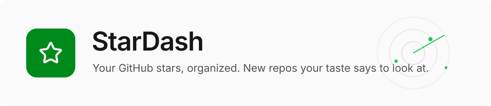
  </picture>
</a>

<p align="center">
  <b>リポジトリにスターを付けても、そのまま忘れてしまいます。StarDash はひとつ残らず覚えていて、代わりに仕分けし、毎晩、あなたのスターから「きっと欲しくなる」と読み取れる新しいリポジトリを見つけます。</b>
</p>

<p align="center">
<a href="https://github.com/boffti/stardash/actions/workflows/ci.yml"></a> <a href="LICENSE"></a> <a href="https://github.com/boffti/stardash/pkgs/container/stardash"></a>  
</p>

<p align="center">
  <a href="#stardash-を使う理由">StarDash を使う理由</a> ·
  <a href="#クイックスタート">クイックスタート</a> ·
  <a href="#使い方">使い方</a> ·
  <a href="#中をのぞく">中をのぞく</a> ·
  <a href="#機能">機能</a> ·
  <a href="#ロードマップ">ロードマップ</a> ·
  <a href="CONTRIBUTING.md">コントリビューション</a> ·
  <a href="README.md">English</a> · <a href="README.zh-CN.md">简体中文</a>
</p>

<p align="center">
  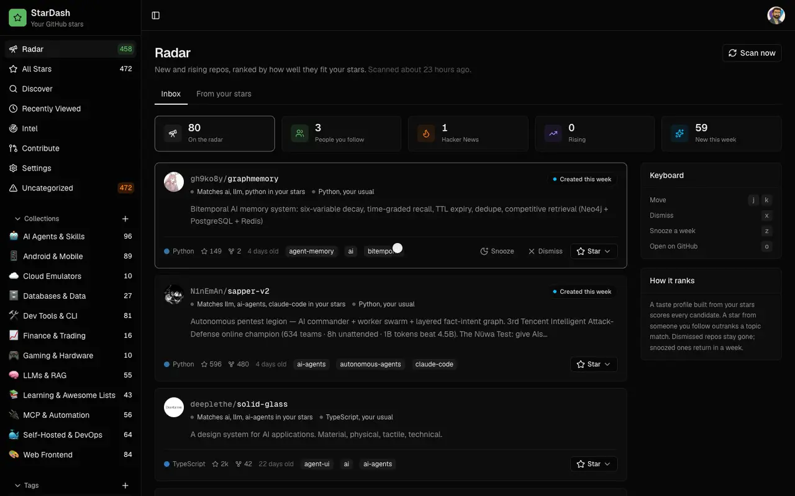
</p>

## StarDash を使う理由

開発者にとって、スターはブックマークの代わりです。ところが数百件を超えると、リストは使いづらくなります。StarDash は、この問題の両面を解決します。

- **付けたスターを見つける。** すべてのスターを、名前、説明、自分のメモ、タグ、コレクションで検索できます。それぞれに `want-to-try`、`currently-using`、`tried-liked`、`tried-dropped`、`just-interesting`、`reference` のいずれかを付ければ、そのリポジトリをどうしたかがリストでわかります。
- **面倒なく仕分ける。** AI が 1 回の処理で最大 500 件のスターを読み込み、5 から 12 個のコレクションと 15 から 25 個のタグを提案して、すべてを振り分けます。作られたものは、そのまま残すことも、名前を変えることも、削除することもできます。
- **次の一つに出会う。** Radar は、新着と急上昇のリポジトリの受信箱です。すでにスターを付けたものとの相性順に並び、どの行にも表示された理由が付いています。

**並び順は GitHub ではなく、あなたの好みで決まります。** Radar は、あなたのスターから好みのプロファイルを作ります。繰り返し戻ってくるトピックと言語を、各リポジトリをどう扱ったかで重み付けしたものです。`tried-dropped` のスターは、そのトピックのマイナス評価になります。毎晩、GitHub 検索、Hacker News、フォロー中の人から候補を集め、このプロファイルに照らして一つずつスコアを付けます。フォロー中の人のスターは、トピックの一致よりも上位に来ます。

**どの行も理由を説明します。** ブラックボックスのスコアはありません。各行には _Matches ai, llm, python in your stars_、_3 people you follow starred this_、_+2.1k stars this week_、_40 points on Hacker News_ などと表示されます。キーボードで 1 週間スヌーズしたり除外したりでき、ワンクリックでスターを付けることもできます。

**エージェントからも使えます。** StarDash には MCP サーバーが付属しています。Claude Code、Cursor などの MCP クライアントから、すでに支払っているサブスクリプションのままで、スターの検索や振り分け、Radar の仕分けができます。

**自分のものを、自分のマシンで。** コンテナ 1 つ、SQLite ファイル 1 つ。サインインするとあなた自身が所有する GitHub App が作られるため、同意画面に他人の名前は出ず、トークンがマシンの外に出ることもありません。

### 同じフィードでも三人三様

Radar が読む新しいリポジトリの集まりは、誰にとっても同じです。上位に何が来るかは、その背後にあるスターで決まります。

| 主にスターを付けるもの           | Radar が最初に出すものと、表示される理由                                                                                    |
| -------------------------------- | --------------------------------------------------------------------------------------------------------------------------- |
| Rust の CLI とターミナルツール   | Hacker News で 40 ポイントを獲得した新しい Rust IDE。_Matches developer-tools, rust, terminal in your stars._               |
| LLM エージェントと MCP サーバー  | 今週作られたエージェントのメモリストア。_Matches ai, llm, python in your stars. Python, your usual._                        |
| 自宅で動かすセルフホストのアプリ | フォロー中の 3 人が昨日スターを付けたホームラボのダッシュボード。_People you follow_ は、どのトピック一致よりも上に来ます。 |

> [!NOTE]
> AI は任意です。検索、ステータス、メモ、Radar、Contribute の issue 一覧の閲覧は、キーなしで動きます。Contribute のブリーフやコーディングアシスタント向けのプロンプトを作るには、AI プロバイダーの設定が必要です。Categorize、Intel、Discover も AI が必要です。OpenRouter のキー（`OPENROUTER_API_KEY`）を設定するか、Settings に自分の OpenAI または Anthropic のキーを貼り付けるか、Ollama などの OpenAI 互換サーバー経由でローカルモデル（`AI_BASE_URL`）を使ってください。既定のモデルなら、500 件のリポジトリをまるごとカテゴリ分けしても 1 セント程度です。

## クイックスタート

Docker が必要です。

```bash
docker run -d --name stardash -p 3000:3000 -v stardash-data:/data ghcr.io/boffti/stardash:latest
```

`http://localhost:3000` を開いて **Connect GitHub** を押します。GitHub にあなた自身が所有する GitHub App を作成するページが表示されるので、**Create GitHub App**、続いて **Authorize** を押してください。OAuth アプリを登録する必要も、シークレットをコピーする必要もありません。スターが同期され、Radar には最初の夜間スキャンで候補が入ります。**Scan now** を押せば、すぐに入ります。

### 別の方法：Docker Compose でインストールする

Compose は、新しくインストールするための別の方法です。上の `docker run` のコマンドと併用せず、その代わりに使ってください。同じホストのポート（`3000`）を公開し、専用の名前付きボリューム（通常は `stardash_stardash-data`）を作るため、別のデータベースを持つ別のインスタンスとして起動します。

```bash
curl -O https://raw.githubusercontent.com/boffti/stardash/main/docker-compose.yml
OPENROUTER_API_KEY=sk-or-... docker compose up -d
```

どちらの方法でインストールした場合も、更新するにはイメージを pull してコンテナを再作成します。データのボリュームは、そのまま使い続けてください。

**既存の `docker run` のインストールを Compose に移す場合：** ボリュームは消さずに古いコンテナを停止して削除し、ダウンロードした Compose ファイルのトップレベルのボリューム宣言を編集して、既存のボリュームを使い回すようにします。

```yaml
volumes:
  stardash-data:
    external: true
    name: stardash-data
```

そのあと Compose を起動します。2 つのコンテナを両方ともポート `3000` で動かさないでください。また、既存のデータベースを使い続けるつもりなら、`external` の指定を省かないでください。

## 仕組み

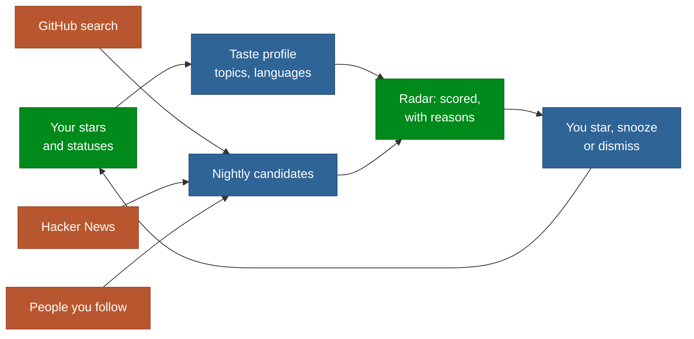

Next.js 16 を 1 プロセスで動かし、SQLite は `node:sqlite` 経由で使います。外部サービスは使いません。毎晩、プロセス内で 2 つのジョブが動きます。Radar に増加ペースの数値を与えるスターのスナップショットと、GitHub 検索、Hacker News（Algolia 経由）、フォロー中の人のスターから Radar に取り込む処理です。スコアリング関数全体は、[`lib/radar.ts`](lib/radar.ts) の 156 行です。

## 使い方

### キーボードで Radar を仕分ける

| キー      | 動作                                                       |
| --------- | ---------------------------------------------------------- |
| `j` / `k` | 受信箱を下へ、上へ移動                                     |
| `x`       | 除外。二度と表示されません。トーストに **Undo** が出ます。 |
| `z`       | 1 週間スヌーズ                                             |
| `o`       | GitHub で開く                                              |

リストの上のタイルで絞り込めます。**People you follow**、**Hacker News**、**Rising**、**New this week** です。**From your stars** には、最近付けたスターから掘り出したおすすめが表示されます。

### エージェントに頼む

Settings で **Agents (MCP)** を開き、**New token** を押して、表示された設定を `.mcp.json`（Claude Code）またはお使いのクライアントの MCP 設定に貼り付けます。

```json
{
  "mcpServers": {
    "stardash": {
      "type": "http",
      "url": "http://localhost:3000/api/mcp",
      "headers": { "Authorization": "Bearer sd_…" }
    }
  }
}
```

あとは、ふだんの言葉でエージェントに話しかけるだけです。

| 話しかける内容                                                              | 起きること                                                                                                                                                                                                    |
| --------------------------------------------------------------------------- | ------------------------------------------------------------------------------------------------------------------------------------------------------------------------------------------------------------- |
| _「ベクトルデータベースで、私がスターを付けたものは？」_                    | `search_stars` が、名前、説明、あなたのメモ、タグ、コレクションを横断して検索します。                                                                                                                         |
| _「duckdb について、私が書いたメモも含めて教えて。」_                       | `get_repo` が、ステータス、メモ、タグ、コレクションと合わせてリポジトリを返します。                                                                                                                           |
| _「スターを付けた MCP サーバーを全部 Agents に入れて、mcp タグを付けて。」_ | `list_taxonomy` と `organize_repo` が、タグとコレクションを作成して割り当てます。先に GitHub のスターを StarDash に同期してください。`organize_repo` は、インスタンスに同期済みのリポジトリにしか使えません。 |
| _「今週の Radar には何がある？」_                                           | `radar_feed` が、並べ替え済みの受信箱を各行の理由つきで返します。                                                                                                                                             |
| _「Radar にある、また別の Electron ラッパーは全部除外して。」_              | `radar_action` が、除外、スヌーズ、取り消しを行います。                                                                                                                                                       |
| _「上位 2 つにスターを付けて、Want to try に入れて。」_                     | `star_repo` が、GitHub でスターを付けます。StarDash でスターを同期してから、`organize_repo` でステータス、タグ、コレクションを割り当ててください。                                                            |

## 中をのぞく

コーヒー片手に眺める受信箱から、最後に使うことになるリポジトリまで。

### Radar

<table>
<tr>
<td width="50%" valign="top">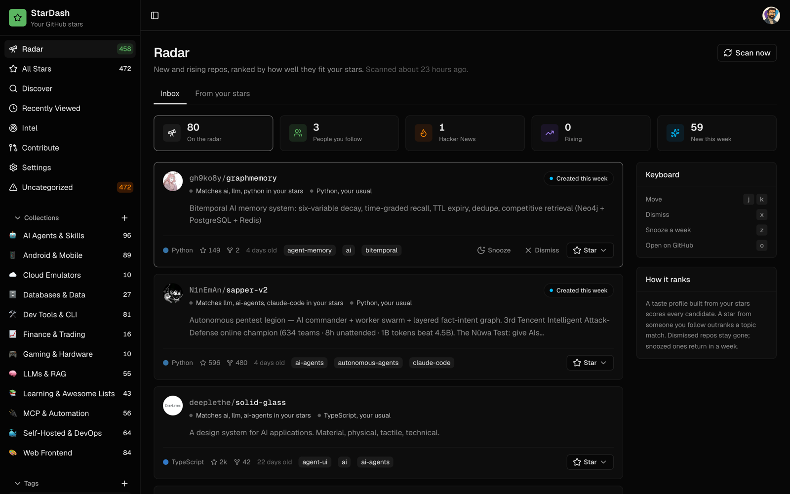<br><b>受信箱。</b> あなたのスターを基準に並べた、新着と急上昇のリポジトリ。各行に一致した理由が書かれ、バッジが最も強いシグナルを示します。</td>
<td width="50%" valign="top">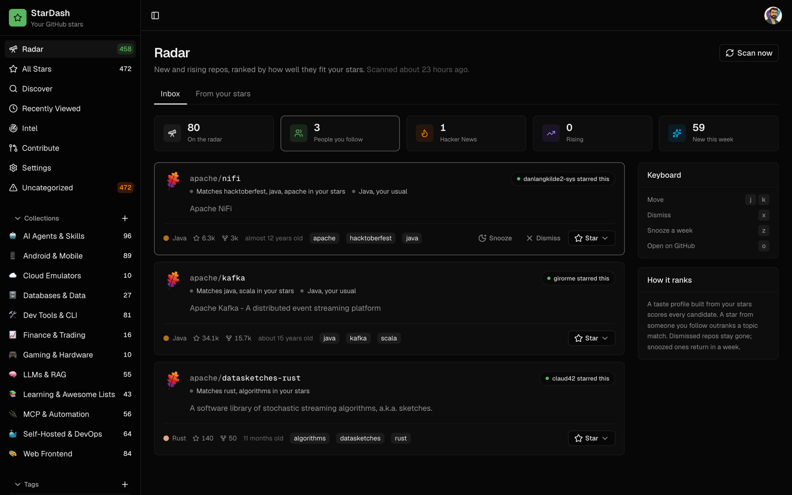<br><b>People you follow。</b> シグナルごとに 1 つのタイルがあり、クリックすると受信箱を絞り込めます。フォロー中の人のスターは、どのトピック一致よりも上に並びます。</td>
</tr>
<tr>
<td width="50%" valign="top">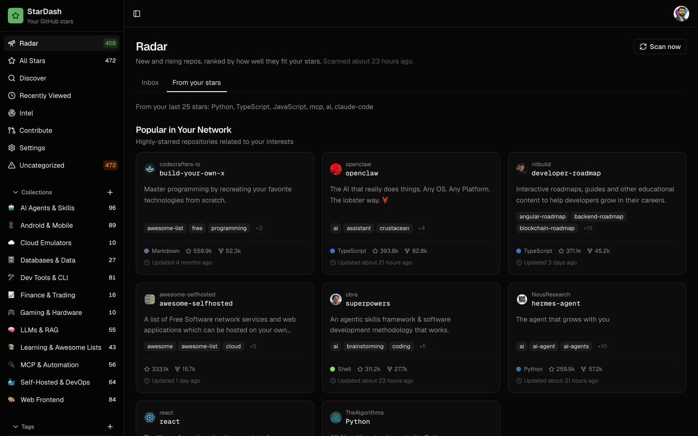<br><b>From your stars。</b> 最近付けたスターから掘り出したおすすめを、共通点ごとにまとめています。</td>
<td width="50%" valign="top">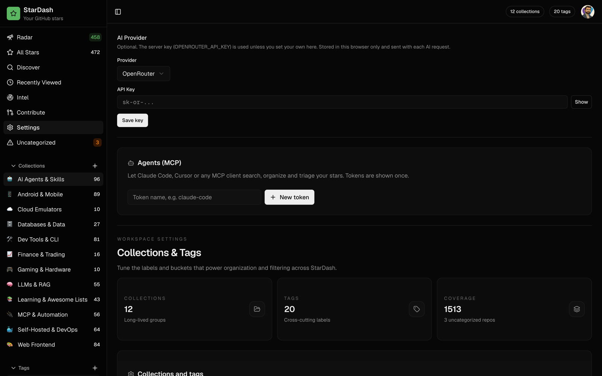<br><b>Agents (MCP)。</b> トークンを発行して設定をコピーすれば、エージェントが検索、振り分け、仕分けまでできます。</td>
</tr>
</table>

### あなたのスター

<table>
<tr>
<td width="50%" valign="top">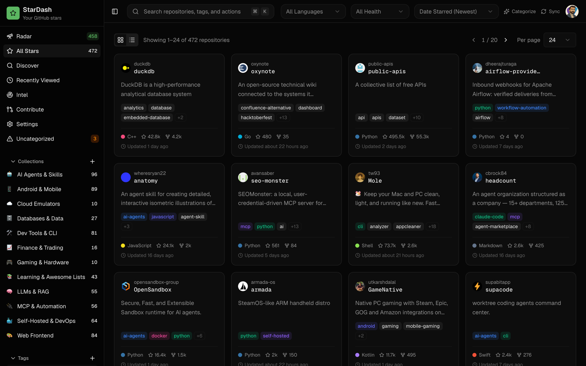<br><b>All Stars。</b> すべてのスターを、名前、説明、メモ、タグ、コレクションで検索できます。</td>
<td width="50%" valign="top">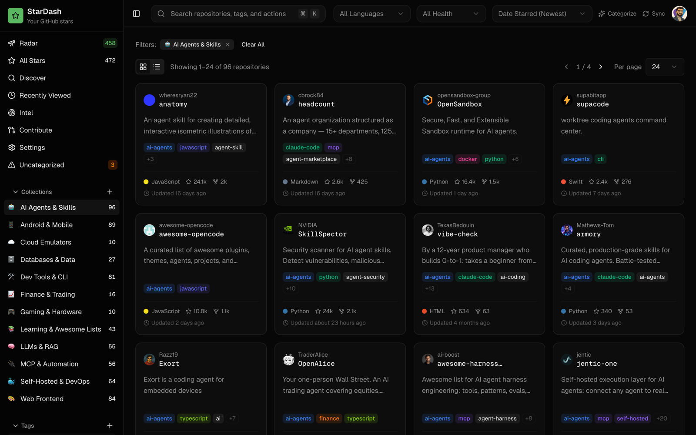<br><b>コレクション。</b> 自分で作ることも、AI がスター全体を 1 回処理して提案し、振り分けてくれることもあります。</td>
</tr>
<tr>
<td width="50%" valign="top">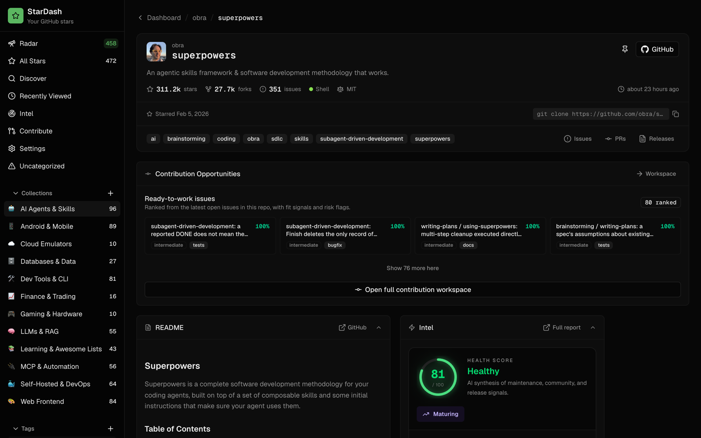<br><b>1 つのリポジトリ。</b> README をその場で表示し、トピック、ヘルスカード、最初のコントリビューションに向いたオープンな issue も並びます。</td>
<td width="50%" valign="top">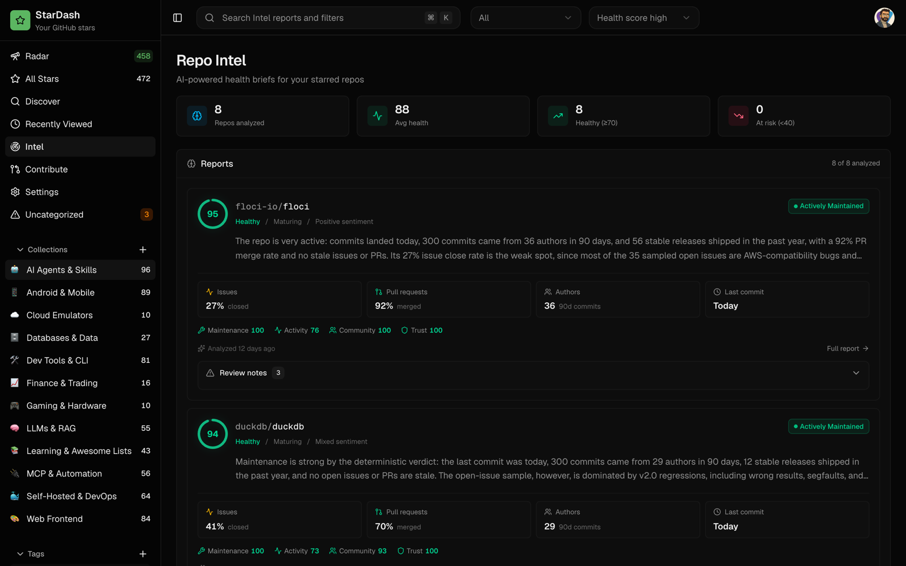<br><b>Intel。</b> リポジトリごとのヘルスブリーフ：スコア、メンテナンス状況の判定、コミュニティのシグナル、ペインポイント。</td>
</tr>
</table>

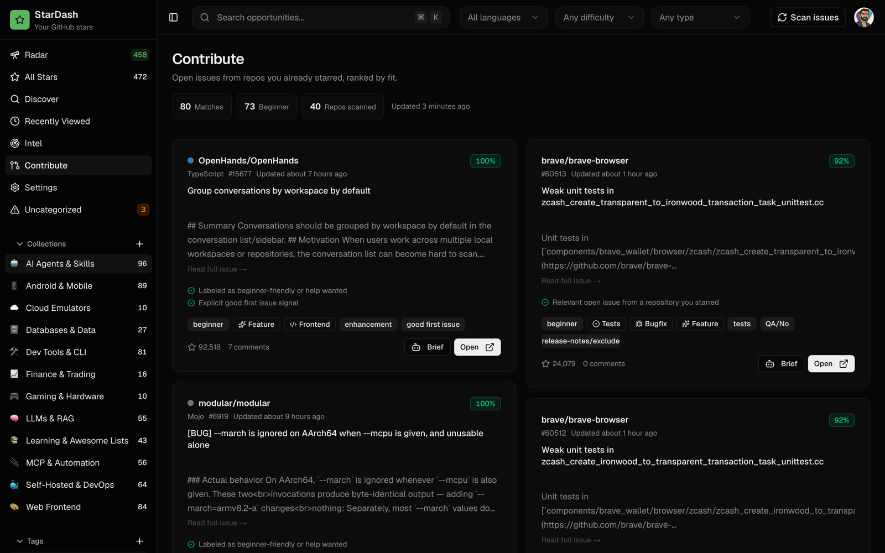

<p align="center"><sub><b>Contribute。</b> すでにスターを付けたリポジトリのオープンな issue を、適合度順に並べます。ワンクリックのブリーフと、コーディングエージェント向けのプロンプトが付きます。</sub></p>

## 機能

<table>
<tr>
<td width="50%" valign="top"><b>Radar</b><br>GitHub 検索、Hacker News、フォロー中の人から集めた新着と急上昇のリポジトリが、毎晩受信箱に届きます。あなたのスターを基準に並び、どれにも理由が付きます。</td>
<td width="50%" valign="top"><b>All Stars</b><br>最大 5,000 件のスターを、名前、説明、メモ、タグ、コレクションで横断検索。それぞれにステータス、メモ、ピン留めを設定できます。</td>
</tr>
<tr>
<td width="50%" valign="top"><b>AI カテゴリ分け</b><br>1 回の処理で、スターからコレクションとタグを提案し、すべてのリポジトリを振り分けます。2 回目以降は、あなたの分類体系を再利用します。</td>
<td width="50%" valign="top"><b>MCP サーバー</b><br>あらゆる MCP クライアント向けの 7 つのツール。Settings または CLI で発行・失効できる bearer トークンで使います。</td>
</tr>
<tr>
<td width="50%" valign="top"><b>Repo Intel</b><br>リポジトリごとのヘルスブリーフ：スコア、メンテナンス状況の判定、コミュニティのシグナル、ペインポイント、推奨。</td>
<td width="50%" valign="top"><b>Contribute</b><br>すでに使っているリポジトリの good first issue。ブリーフと、コーディングエージェントにそのまま貼り付けられるプロンプト付き。</td>
</tr>
<tr>
<td width="50%" valign="top"><b>Discover</b><br>作っているものを説明すると、AI がクエリを広げ、あなたのスターを基準に GitHub 検索の結果を並べ替えます。</td>
<td width="50%" valign="top"><b>1 つのコンテナ</b><br>イメージ 1 つ、SQLite ファイル 1 つ、ボリューム 1 つ。amd64 と arm64 に対応。夜間ジョブはプロセス内で実行。Postgres も Redis も不要です。</td>
</tr>
</table>

## あなたのデータ

> [!IMPORTANT]
> スター、ステータス、メモ、分類、Radar の履歴、GitHub App の認証情報は、`/data` ボリューム上の 1 つの SQLite ファイルに保存されます。StarDash がやり取りするのは GitHub と Hacker News の検索 API で、AI 機能を使ったときは、設定した AI プロバイダーに AI のリクエストを送ります。任意の監視の連携を設定した場合は、その送り先にもテレメトリが送られます。Sentry の DSN を設定すると Sentry にエラーとパフォーマンスのイベントが、`LANGFUSE_PUBLIC_KEY` と `LANGFUSE_SECRET_KEY` の両方を設定したときだけ Langfuse に AI のトレースが送られます。

| 内容                                         | 保存場所                                                |
| -------------------------------------------- | ------------------------------------------------------- |
| スター、メモ、ステータス、タグ、コレクション | ボリューム上の `stardash.db`                            |
| GitHub App の ID とシークレット              | `stardash.db`。セットアップ時にあなたのアカウントで作成 |
| サインイン情報                               | 署名付き cookie。シークレットは初回起動時に生成         |
| MCP トークン                                 | SHA-256 ハッシュだけを保存                              |

オーナーは 1 人だけです。最初にサインインした GitHub アカウントが、このインスタンスを所有します。

<details>
<summary><strong>設定</strong></summary>

すべて任意です。

| 変数                                        | 用途                                                                                                                        |
| ------------------------------------------- | --------------------------------------------------------------------------------------------------------------------------- |
| `OPENROUTER_API_KEY`                        | AI 機能を有効にします。                                                                                                     |
| `AI_MODEL`                                  | 任意の OpenRouter のモデル ID。既定は、構造化出力を扱える安価なモデルです。                                                 |
| `AI_BASE_URL`                               | OpenAI 互換のエンドポイント（Ollama、LM Studio、vLLM）。OpenRouter の代わりに使われ、`AI_MODEL` が必要です。                |
| `AI_API_KEY`                                | `AI_BASE_URL` 用のキー。サーバーが必要とする場合のみ。                                                                      |
| `APP_URL`                                   | 公開オリジン。リバースプロキシが `X-Forwarded-Host` と `X-Forwarded-Proto` を送らない場合に使います。                       |
| `GITHUB_CLIENT_ID` / `GITHUB_CLIENT_SECRET` | ワンクリックの手順の代わりに、自分で作成した GitHub App を使います。                                                        |
| `GITHUB_PAT`                                | 夜間ジョブ用のトークン。既定ではオーナーのトークンです。                                                                    |
| `CRON_SECRET`                               | 外部のスケジューラーから `/api/cron/*` を呼び出せるようにします。`DISABLE_SCHEDULER=1` でプロセス内のジョブを無効にします。 |
| `NEXT_PUBLIC_RADAR_ENABLED`                 | `false` で Radar を非表示にします。                                                                                         |
| `DATABASE_PATH`                             | SQLite ファイル。コンテナ内では `/data/stardash.db` です。                                                                  |

**ローカルモデル：** ホストで Ollama を実行し、JSON 出力をうまく扱えるモデルを pull して（`ollama pull qwen3:8b`）、`AI_BASE_URL=http://host.docker.internal:11434/v1` と `AI_MODEL=qwen3:8b` を設定します。`pnpm dev` から実行する場合は `http://localhost:11434/v1` を使ってください。8B のモデルには、空きメモリが約 8 GB 必要です。2B 未満のモデルも動きますが、分類の質が低くなります（すべてが 1 つのコレクションに入ってしまいます）。Categorize や Intel が失敗したり、結果がおかしかったりする場合は、もっと大きなモデルを試してください。

**ブラウザのないマシンの場合：** ログインページで _Paste a personal access token instead_ を選びます。StarDash が通信するのは GitHub.com だけで、GitHub Enterprise Server にはまだ対応していません。

**LAN 内のプレーン HTTP** でも使えます。その場合、セッション cookie に Secure は付きません。公開する場合は HTTPS の背後に置いてください。

#### リバースプロキシ

プロキシで TLS を終端し、元のホストとプロトコルを転送します。GitHub App のセットアップ URL と OAuth のコールバック URL は、このオリジンから組み立てられます。

**Caddy**

```caddyfile
stardash.example.com {
    reverse_proxy 127.0.0.1:3000 {
        header_up Host {host}
        header_up X-Forwarded-Host {host}
        header_up X-Forwarded-Proto {scheme}
    }
}
```

**nginx**

```nginx
server {
    listen 443 ssl;
    server_name stardash.example.com;

    # ssl_certificate and ssl_certificate_key go here.
    location / {
        proxy_pass http://127.0.0.1:3000;
        proxy_set_header Host $host;
        proxy_set_header X-Forwarded-Host $host;
        proxy_set_header X-Forwarded-Proto $scheme;
    }
}
```

3000 番ポートは非公開にし、公開トラフィックはプロキシに任せます。`APP_URL` が設定されていればそれが優先されます。なければ `X-Forwarded-Host` と `X-Forwarded-Proto` から、それもなければリクエスト URL からオリジンを決めます。プロキシがこれらのヘッダーを確実に渡せない場合や、正規のオリジンを固定したい場合は、`APP_URL=https://stardash.example.com`（パスなし、末尾のスラッシュなし）を設定してください。転送ヘッダーを信頼するのは、自分で管理しているプロキシのものだけにしてください。

**Docker を使わない場合：** Node 22.5 以降と pnpm を用意して、`pnpm install && pnpm build && pnpm start` を実行します。

</details>

## ロードマップ

- [x] SQLite 上の単一コンテナと、自分で所有する GitHub App 経由のサインイン
- [x] Radar：GitHub 検索、Hacker News、フォロー中の人から夜間に集めた候補を、スターを基準にランキング
- [x] MCP サーバーと CLI トークン
- [x] 安価なモデルでの AI カテゴリ分け、Intel、Contribute、Discover
- [ ] `v1.0.0` のリリース
- [ ] エージェントのサブスクリプションから CLI 経由で AI 機能を動かす（API キーはフォールバック）
- [ ] 毎週のリリース。それぞれ目に見える変更を 1 つ含める

全体の計画は [ROADMAP.md](ROADMAP.md) をご覧ください。アイデアがありますか？[issue を開いてください](https://github.com/boffti/stardash/issues)。

## コントリビューション

```bash
pnpm install && pnpm dev     # sign in at http://localhost:3000; you are running the real thing
pnpm typecheck && pnpm lint && pnpm check:db && pnpm check:radar
```

[good first issue](https://github.com/boffti/stardash/issues?q=is%3Aissue+is%3Aopen+label%3A%22good+first+issue%22) ラベルの付いた issue は、小さく独立しています。規約は [CONTRIBUTING.md](CONTRIBUTING.md) にあります。セキュリティ上の問題を報告する場合は、[SECURITY.md](SECURITY.md) に従ってください。

<details>
<summary><strong>AI エージェント向け</strong></summary>

まず [AGENTS.md](AGENTS.md) を読んでください。`lib/db.ts` のスキーマ、認証フロー、Radar のスコアリング、`lib/mcp-tools.ts` の MCP ツール、すべてのページが従う UI ルールをまとめています。

</details>

<details>
<summary><strong>コマンドラインリファレンス</strong></summary>

`bin/stardash.mjs` は SQLite ファイルを直接操作します。コンテナの場合は、先頭に `docker exec stardash node` を付けます。

```
bin/stardash.mjs token [name]       # mint an MCP token and print it once
bin/stardash.mjs tokens             # list tokens and when each was last used
bin/stardash.mjs revoke <id>        # revoke a token
bin/stardash.mjs mcp-config [tok]   # print the .mcp.json block for a token
```

</details>

## ライセンス

[MIT](LICENSE)
