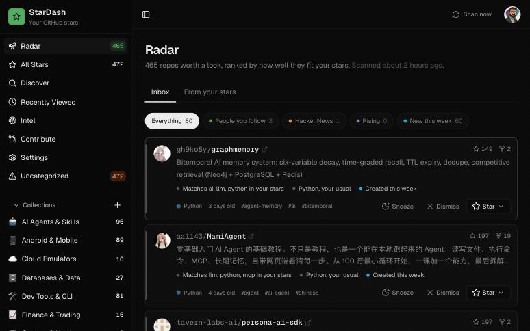

<div align="center">

<h1>StarDash</h1>

<p>You star repos and forget them. StarDash remembers, and tells you which new ones your taste says to look at.</p>



<br/>

[](./LICENSE)
[](https://github.com/boffti/stardash/pkgs/container/stardash)
[](#use-it-from-your-ai-agent-mcp)
[](https://github.com/boffti/stardash/stargazers)

[简体中文](./README.zh-CN.md)

</div>

## Run it

```bash
docker run -d --name stardash -p 3000:3000 -v stardash-data:/data ghcr.io/boffti/stardash:latest
```

Open http://localhost:3000, click **Connect GitHub**, click **Create GitHub App**, authorize. Two clicks on GitHub, no OAuth app to register, no secrets to copy. Your stars sync and Radar fills overnight (or hit **Scan now**).

Everything lives in one SQLite file on the volume. The GitHub App it creates is owned by you.

## What you get

|                        |                                                                                                                                                                                                                                                                                               |
| ---------------------- | --------------------------------------------------------------------------------------------------------------------------------------------------------------------------------------------------------------------------------------------------------------------------------------------- |
| **Radar**              | Inbox of new and rising repos from GitHub search, Hacker News and the people you follow, ranked against your own stars. Every row says why: "3 people you follow starred this", "+2.1k stars this week", "matches local-first, sqlite". Star, snooze, dismiss. Keyboard: `j` `k` `x` `z` `o`. |
| **All Stars**          | Every starred repo, searchable across name, description, notes, tags and collections. Status per repo (`want-to-try`, `currently-using`, `tried-liked`, `tried-dropped`, `just-interesting`, `reference`), notes, pins, inline README.                                                        |
| **Collections & tags** | Yours, or generated: one AI pass over up to 500 repos produces 5 to 12 collections and 15 to 25 tags and files everything.                                                                                                                                                                    |
| **Repo Intel**         | A health report per repo: score, maintenance verdict, community signals, pain points, recommendation.                                                                                                                                                                                         |
| **Contribute**         | Open issues from repos you already starred, ranked by fit, with a one-click brief and a ready-to-paste coding-assistant prompt.                                                                                                                                                               |
| **Discover**           | Describe what you are building; AI expands the query and reranks GitHub search.                                                                                                                                                                                                               |
| **MCP server**         | Claude Code, Cursor or any MCP client can search, organize and triage your stars with your own subscription.                                                                                                                                                                                  |

AI features need an OpenRouter key (`OPENROUTER_API_KEY`, or your own key pasted in Settings). A full categorize run over 500 repos costs about a cent on the default model. Everything else works without a key.

## Use it from your AI agent (MCP)

1. Settings → **Agents (MCP)** → New token. Copy the config it shows.
2. Paste into `.mcp.json` (Claude Code) or your client's MCP settings.

```json
{
  "mcpServers": {
    "stardash": {
      "type": "http",
      "url": "http://localhost:3000/api/mcp",
      "headers": { "Authorization": "Bearer sd_…" }
    }
  }
}
```

Tools: `search_stars`, `get_repo`, `list_taxonomy`, `organize_repo`, `radar_feed`, `radar_action`, `star_repo`. From a shell instead: `docker exec stardash node bin/stardash.mjs token claude-code`.

## Configuration

All optional.

| Variable                                    | Purpose                                                                                                                   |
| ------------------------------------------- | ------------------------------------------------------------------------------------------------------------------------- |
| `OPENROUTER_API_KEY`                        | Turns on the AI features.                                                                                                 |
| `AI_MODEL`                                  | Any OpenRouter model id. Default is a cheap structured-output model.                                                      |
| `APP_URL`                                   | Public origin, when a reverse proxy does not send `X-Forwarded-Host` and `X-Forwarded-Proto`.                             |
| `GITHUB_CLIENT_ID` / `GITHUB_CLIENT_SECRET` | Use a pre-made GitHub App instead of the one-click flow.                                                                  |
| `GITHUB_PAT`                                | Token for the nightly jobs. Defaults to the signed-in owner's.                                                            |
| `CRON_SECRET`                               | Lets an external scheduler call `/api/cron/*`. Nightly jobs already run in-process. `DISABLE_SCHEDULER=1` turns them off. |
| `NEXT_PUBLIC_RADAR_ENABLED`                 | `false` hides Radar.                                                                                                      |
| `DATABASE_PATH`                             | SQLite file. `/data/stardash.db` in the container.                                                                        |

Compose, with a key:

```bash
curl -O https://raw.githubusercontent.com/boffti/stardash/main/docker-compose.yml
OPENROUTER_API_KEY=sk-or-... docker compose up -d
```

**GitHub Enterprise or no browser on the box:** choose "Paste a personal access token instead" on the login page.

**Plain HTTP on a LAN** works; the session cookie just is not marked Secure. Put it behind HTTPS for anything public.

**Without Docker:** Node 22.5+ and pnpm, then `pnpm install && pnpm build && pnpm start`.

## How it works

Next.js 16 app, one process. Data is SQLite through `node:sqlite`, no ORM, no external services. Sign-in uses the GitHub App manifest flow: the instance asks GitHub to create an app owned by you, stores its credentials locally, then runs normal OAuth with 8-hour tokens and refresh. Nightly, in-process: star snapshots (for velocity) and the Radar ingest (GitHub search, Hacker News via Algolia, stars by people you follow). Radar scoring is a taste profile from your stars (topics and languages weighted by status; `tried-dropped` counts against) applied to every candidate; social signal outranks a topic match. The whole scoring function is 156 lines in `lib/radar.ts`.

## Contributing

`pnpm install && pnpm dev`, sign in, you are running the real thing. `pnpm typecheck && pnpm lint && pnpm check:db && pnpm check:radar` before a PR. Issues labelled [good first issue](https://github.com/boffti/stardash/issues?q=is%3Aissue+is%3Aopen+label%3A%22good+first+issue%22) are small and self-contained; the [roadmap](https://github.com/boffti/stardash/issues/86) says what is next. See [CONTRIBUTING.md](./CONTRIBUTING.md).

## License

MIT
