<a href="https://github.com/boffti/stardash">
  <picture>
    <source media="(prefers-color-scheme: dark)" srcset="assets/brand/banner-dark.svg">
    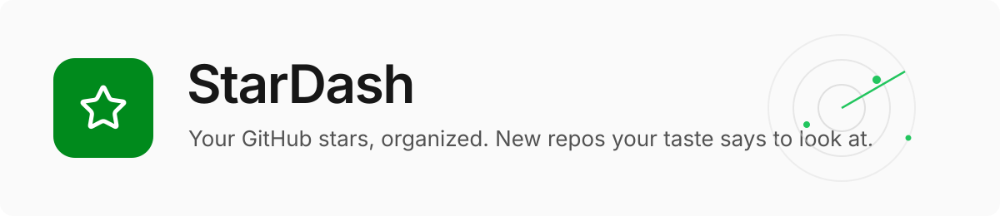
  </picture>
</a>

<p align="center">
  <b>You star repos and forget them. StarDash remembers every one, sorts them for you, and every night finds the new repos your own stars say you will want.</b>
</p>

<p align="center">
<a href="https://github.com/boffti/stardash/actions/workflows/ci.yml"></a> <a href="LICENSE"></a> <a href="https://github.com/boffti/stardash/pkgs/container/stardash"></a>  
</p>

<p align="center">
  <a href="#why-stardash">Why StarDash</a> ·
  <a href="#quick-start">Quick start</a> ·
  <a href="#how-to-use-it">How to use it</a> ·
  <a href="#a-look-inside">A look inside</a> ·
  <a href="#features">Features</a> ·
  <a href="#roadmap">Roadmap</a> ·
  <a href="CONTRIBUTING.md">Contributing</a> ·
  <a href="README.zh-CN.md">简体中文</a>
</p>

<p align="center">
  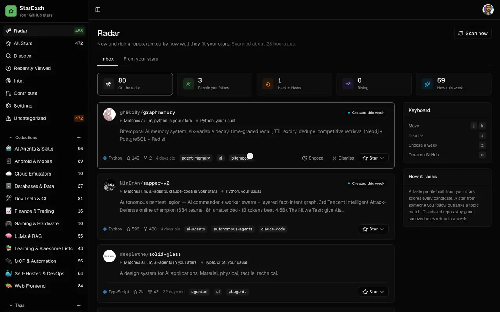
</p>

## Why StarDash

Starring is how developers bookmark. Then the list grows past a few hundred and stops being useful. StarDash fixes both halves of that:

- **Find what you starred.** Every star is searchable by name, description, your notes, tags and collections. Mark each one `want-to-try`, `currently-using`, `tried-liked`, `tried-dropped`, `just-interesting` or `reference`, so the list says what you did with it.
- **Sort it without the chore.** One AI pass reads up to 500 of your stars and proposes 5 to 12 collections and 15 to 25 tags, then files everything. Keep, rename or delete what it made.
- **Hear about the next one.** Radar is an inbox of new and rising repos, ranked by how well they fit what you already star, and every row says why it is there.

**Ranked by your taste, not by GitHub's.** Radar builds a profile from your stars: the topics and languages you keep coming back to, weighted by what you did with each repo. A `tried-dropped` star counts against its topics. Every night it pulls candidates from GitHub search, Hacker News and the people you follow, and scores each one against that profile. A star from someone you follow outranks a topic match.

**Every row explains itself.** No black-box score. A row says _Matches ai, llm, python in your stars_, _3 people you follow starred this_, _+2.1k stars this week_ or _40 points on Hacker News_. Snooze it for a week or dismiss it from the keyboard, or star it in one click.

**Your agent can use it.** StarDash ships an MCP server. Claude Code, Cursor or any MCP client can search your stars, file them, and triage Radar on the subscription you already pay for.

**Yours, on your machine.** One container, one SQLite file. Sign-in creates a GitHub App that you own, so no one else's name is on the consent screen and no token leaves your box.

### Same feed, three people

Radar reads the same pool of new repos for everyone. What reaches the top depends on the stars behind it:

| You mostly star                  | What Radar puts first, and the reason it shows                                                                  |
| -------------------------------- | --------------------------------------------------------------------------------------------------------------- |
| Rust CLIs and terminal tools     | A new Rust IDE with 40 points on Hacker News. _Matches developer-tools, rust, terminal in your stars._          |
| LLM agents and MCP servers       | An agent memory store created this week. _Matches ai, llm, python in your stars. Python, your usual._           |
| Self-hosted apps you run at home | A home-lab dashboard three people you follow starred yesterday. _People you follow_ outranks every topic match. |

> [!NOTE]
> AI is optional. Search, status, notes, Radar and browsing the Contribute issue list work without a key. Generating a Contribute brief or coding-assistant prompt requires a configured AI provider. Categorize, Intel and Discover also require AI. Configure an OpenRouter key (`OPENROUTER_API_KEY`), paste your own OpenAI or Anthropic key in Settings, or use a local model through an OpenAI-compatible server such as Ollama (`AI_BASE_URL`). A full categorize run over 500 repos costs about a cent on the default model.

## Quick start

You need Docker.

```bash
docker run -d --name stardash -p 3000:3000 -v stardash-data:/data ghcr.io/boffti/stardash:latest
```

Open `http://localhost:3000` and press **Connect GitHub**. GitHub shows a page that creates a GitHub App owned by you: press **Create GitHub App**, then **Authorize**. There is no OAuth app to register and no secret to copy. Your stars sync, and Radar fills on the first nightly scan, or right away when you press **Scan now**.

### Alternative: install with Docker Compose

Compose is an alternative fresh install; use it instead of the `docker run` command above, not alongside it. It publishes the same host port (`3000`) and creates its own named volume (normally `stardash_stardash-data`), so it starts a separate instance with a separate database.

```bash
curl -O https://raw.githubusercontent.com/boffti/stardash/main/docker-compose.yml
OPENROUTER_API_KEY=sk-or-... docker compose up -d
```

To update either installation, pull the image and recreate its container. Keep using the same data volume.

**Moving an existing `docker run` install to Compose:** stop and remove the old container without deleting its volume, then edit the downloaded Compose file's top-level volume declaration to reuse that existing volume:

```yaml
volumes:
  stardash-data:
    external: true
    name: stardash-data
```

Then start Compose. Do not run both containers on port `3000`, and do not omit the `external` mapping when you intend to keep using the existing database.

## How it works

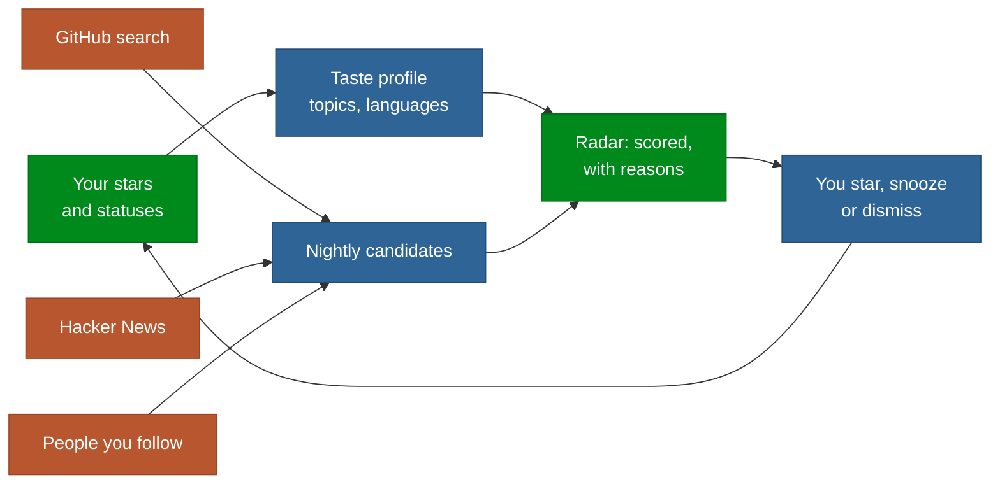

Next.js 16 in one process, SQLite through `node:sqlite`, no external services. Two jobs run in-process every night: star snapshots, which give Radar its velocity numbers, and the Radar ingest from GitHub search, Hacker News (through Algolia) and the stars of people you follow. The whole scoring function is 156 lines in [`lib/radar.ts`](lib/radar.ts).

## How to use it

### Triage Radar from the keyboard

| Key       | What it does                                     |
| --------- | ------------------------------------------------ |
| `j` / `k` | Move down and up the inbox                       |
| `x`       | Dismiss. It stays gone. A toast offers **Undo**. |
| `z`       | Snooze for a week                                |
| `o`       | Open on GitHub                                   |

The tiles above the list filter it: **People you follow**, **Hacker News**, **Rising**, **New this week**. **From your stars** shows recommendations mined from your own recent stars.

### Ask your agent

In Settings, open **Agents (MCP)**, press **New token**, and paste the config it shows into `.mcp.json` (Claude Code) or your client's MCP settings:

```json
{
  "mcpServers": {
    "stardash": {
      "type": "http",
      "url": "http://localhost:3000/api/mcp",
      "headers": { "Authorization": "Bearer sd_…" }
    }
  }
}
```

Then talk to your agent in plain words:

| You say                                                            | What happens                                                                                                                                                                                 |
| ------------------------------------------------------------------ | -------------------------------------------------------------------------------------------------------------------------------------------------------------------------------------------- |
| _"What did I star about vector databases?"_                        | `search_stars` looks across names, descriptions, your notes, tags and collections.                                                                                                           |
| _"Tell me about duckdb and what I wrote about it."_                | `get_repo` returns the repo with your status, notes, tags and collections.                                                                                                                   |
| _"File every MCP server I starred under Agents and tag them mcp."_ | `list_taxonomy` and `organize_repo` create and assign tags and collections. Sync your GitHub stars in StarDash first; `organize_repo` only works on repos already synced into your instance. |
| _"What's on my radar this week?"_                                  | `radar_feed` returns the ranked inbox with each row's reasons.                                                                                                                               |
| _"Dismiss anything on my radar that is another Electron wrapper."_ | `radar_action` dismisses, snoozes or undoes.                                                                                                                                                 |
| _"Star the top two and put them in Want to try."_                  | `star_repo` stars them on GitHub. Sync your stars in StarDash, then use `organize_repo` to assign a status, tags or collections.                                                             |

## A look inside

From the inbox you check over coffee to the repo you end up using.

### Radar

<table>
<tr>
<td width="50%" valign="top">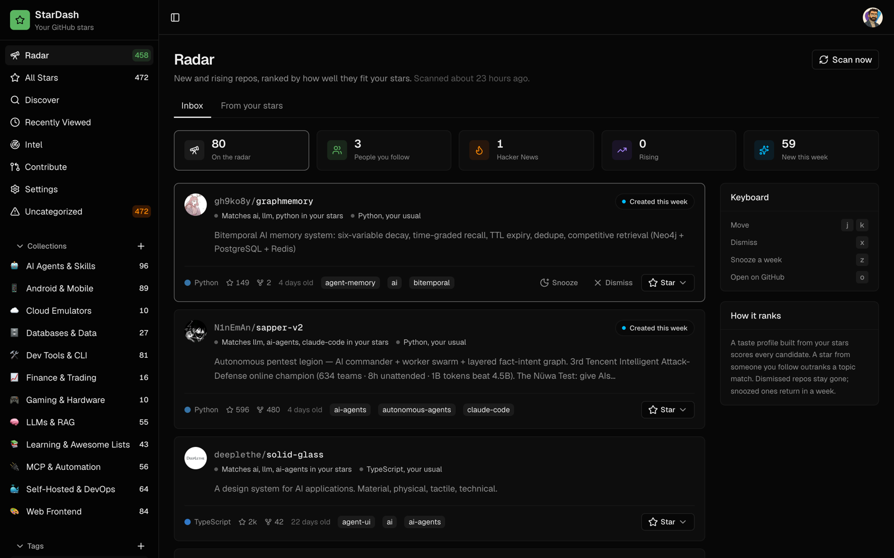<br><b>Inbox.</b> New and rising repos ranked against your stars. Each row says why it matched, and the badge names its strongest signal.</td>
<td width="50%" valign="top">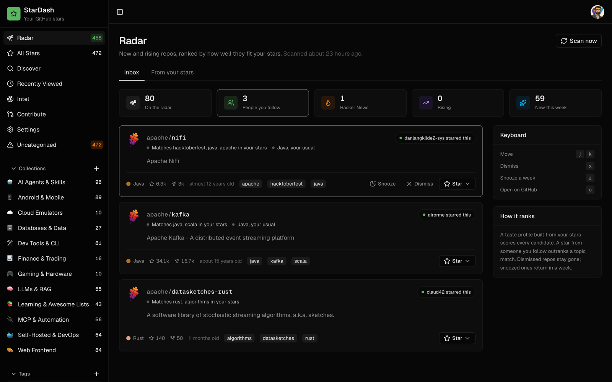<br><b>People you follow.</b> One tile per signal filters the inbox. A star from someone you follow ranks above any topic match.</td>
</tr>
<tr>
<td width="50%" valign="top">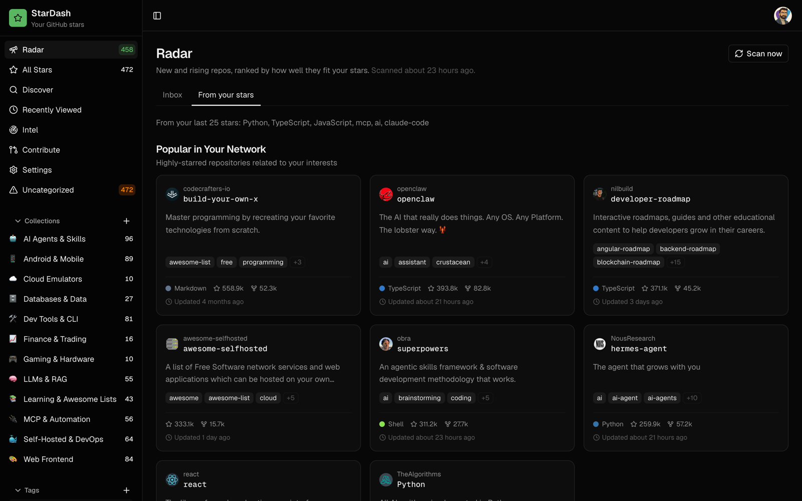<br><b>From your stars.</b> Recommendations mined from your own recent stars, grouped by what they have in common.</td>
<td width="50%" valign="top">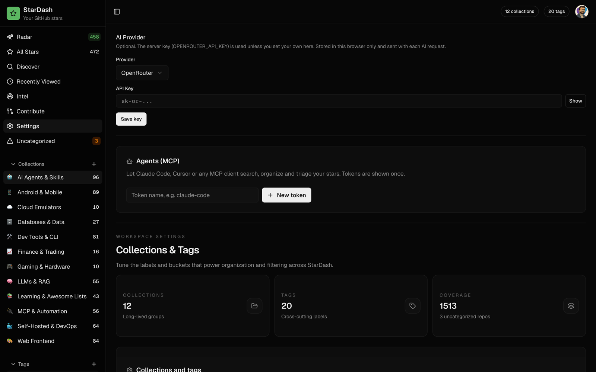<br><b>Agents (MCP).</b> Mint a token, copy the config, and your agent can search, file and triage.</td>
</tr>
</table>

### Your stars

<table>
<tr>
<td width="50%" valign="top">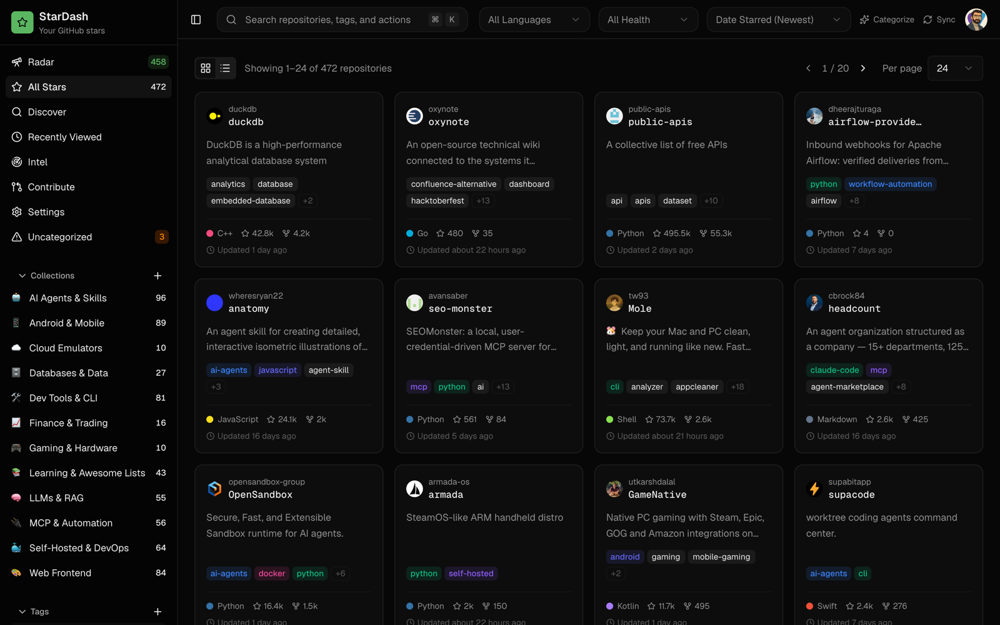<br><b>All Stars.</b> Every star, searchable by name, description, notes, tags and collections.</td>
<td width="50%" valign="top">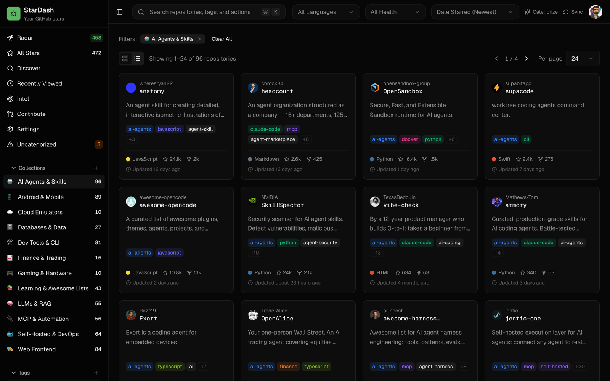<br><b>Collections.</b> Yours, or proposed by one AI pass over your stars and filed for you.</td>
</tr>
<tr>
<td width="50%" valign="top">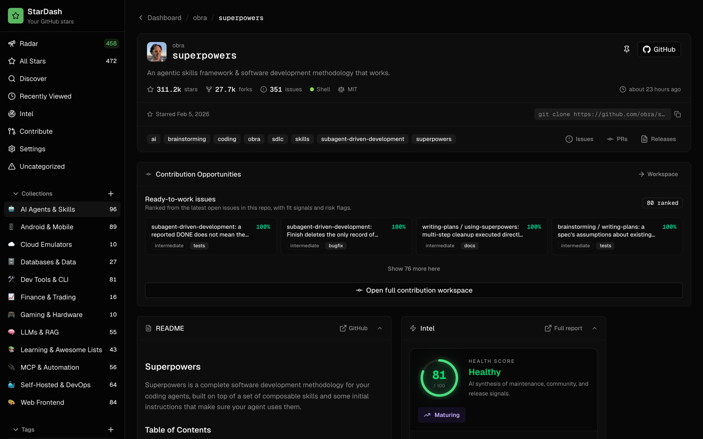<br><b>One repo.</b> The README inline, its topics, a health card, and open issues ready for a first contribution.</td>
<td width="50%" valign="top">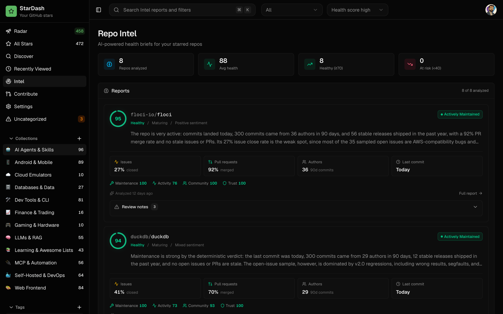<br><b>Intel.</b> A health brief per repo: score, maintenance verdict, community signals and pain points.</td>
</tr>
</table>

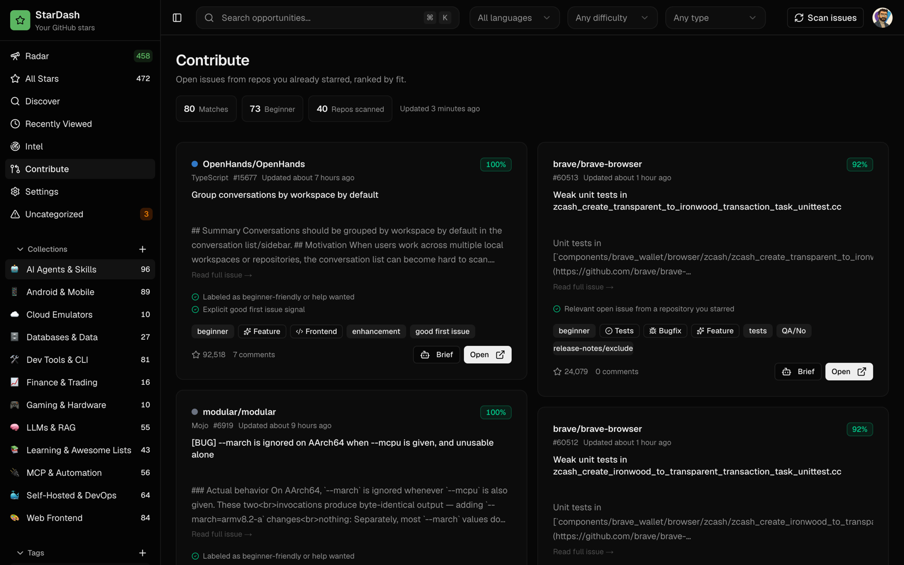

<p align="center"><sub><b>Contribute.</b> Open issues from repos you already starred, ranked by fit, with a one-click brief and a prompt for your coding agent.</sub></p>

## Features

<table>
<tr>
<td width="50%" valign="top"><b>Radar</b><br>A nightly inbox of new and rising repos from GitHub search, Hacker News and the people you follow, ranked against your stars, each with its reasons.</td>
<td width="50%" valign="top"><b>All Stars</b><br>Up to 5,000 stars, searchable across names, descriptions, notes, tags and collections, with a status, notes and a pin on each.</td>
</tr>
<tr>
<td width="50%" valign="top"><b>AI categorize</b><br>One pass proposes collections and tags from your stars and files every repo. It reuses your taxonomy on later runs.</td>
<td width="50%" valign="top"><b>MCP server</b><br>Seven tools for any MCP client, on bearer tokens you mint and revoke in Settings or from the CLI.</td>
</tr>
<tr>
<td width="50%" valign="top"><b>Repo Intel</b><br>A health brief per repo: score, maintenance verdict, community signals, pain points and a recommendation.</td>
<td width="50%" valign="top"><b>Contribute</b><br>Good first issues from repos you already use, with a brief and a ready-to-paste prompt for your coding agent.</td>
</tr>
<tr>
<td width="50%" valign="top"><b>Discover</b><br>Describe what you are building. AI expands the query and reranks GitHub search against your stars.</td>
<td width="50%" valign="top"><b>One container</b><br>One image, one SQLite file, one volume. amd64 and arm64. Nightly jobs run in-process. No Postgres, no Redis.</td>
</tr>
</table>

## Your data

> [!IMPORTANT]
> Your stars, statuses, notes, taxonomy, Radar history and GitHub App credentials live in one SQLite file on the `/data` volume. StarDash communicates with GitHub and Hacker News's search API, and sends AI requests to your configured AI provider when you use AI features. Optional observability integrations also send telemetry to their configured services: Sentry receives error/performance events when a Sentry DSN is set; Langfuse receives AI traces only when both `LANGFUSE_PUBLIC_KEY` and `LANGFUSE_SECRET_KEY` are set.

| What                                      | Where                                                 |
| ----------------------------------------- | ----------------------------------------------------- |
| Stars, notes, statuses, tags, collections | `stardash.db` on the volume                           |
| GitHub App id and secret                  | `stardash.db`, created on your account during setup   |
| Your sign-in                              | A signed cookie whose secret is minted on first start |
| MCP tokens                                | Only their SHA-256 hashes are stored                  |

Single owner: the first GitHub account to sign in owns the instance.

<details>
<summary><strong>Configuration</strong></summary>

All optional.

| Variable                                    | Purpose                                                                                                |
| ------------------------------------------- | ------------------------------------------------------------------------------------------------------ |
| `OPENROUTER_API_KEY`                        | Turns on the AI features.                                                                              |
| `AI_MODEL`                                  | Any OpenRouter model id. The default is a cheap model that handles structured output.                  |
| `AI_BASE_URL`                               | An OpenAI-compatible endpoint (Ollama, LM Studio, vLLM). Used instead of OpenRouter; needs `AI_MODEL`. |
| `AI_API_KEY`                                | Key for `AI_BASE_URL`, if the server wants one.                                                        |
| `APP_URL`                                   | Public origin, when a reverse proxy does not send `X-Forwarded-Host` and `X-Forwarded-Proto`.          |
| `GITHUB_CLIENT_ID` / `GITHUB_CLIENT_SECRET` | Use a GitHub App you made yourself instead of the one-click flow.                                      |
| `GITHUB_PAT`                                | Token for the nightly jobs. Defaults to the owner's.                                                   |
| `CRON_SECRET`                               | Lets an external scheduler call `/api/cron/*`. `DISABLE_SCHEDULER=1` turns the in-process jobs off.    |
| `NEXT_PUBLIC_RADAR_ENABLED`                 | `false` hides Radar.                                                                                   |
| `DATABASE_PATH`                             | The SQLite file. `/data/stardash.db` in the container.                                                 |

**Local models:** run Ollama on the host, pull a model that handles JSON output well (`ollama pull qwen3:8b`), then set `AI_BASE_URL=http://host.docker.internal:11434/v1` and `AI_MODEL=qwen3:8b`. From `pnpm dev` use `http://localhost:11434/v1`. An 8B model needs roughly 8 GB of free RAM. Models under 2B run but group poorly (everything lands in one collection); if Categorize or Intel fails or looks wrong, try a larger one.

**No browser on the box:** choose _Paste a personal access token instead_ on the login page. StarDash talks to GitHub.com only; GitHub Enterprise Server is not supported yet.

**Plain HTTP on a LAN** works. The session cookie is not marked Secure there. Put it behind HTTPS for anything public.

#### Reverse proxy

Terminate TLS at the proxy and forward the original host and protocol. The GitHub App setup and OAuth callback URLs are built from that origin.

**Caddy**

```caddyfile
stardash.example.com {
    reverse_proxy 127.0.0.1:3000 {
        header_up Host {host}
        header_up X-Forwarded-Host {host}
        header_up X-Forwarded-Proto {scheme}
    }
}
```

**nginx**

```nginx
server {
    listen 443 ssl;
    server_name stardash.example.com;

    # ssl_certificate and ssl_certificate_key go here.
    location / {
        proxy_pass http://127.0.0.1:3000;
        proxy_set_header Host $host;
        proxy_set_header X-Forwarded-Host $host;
        proxy_set_header X-Forwarded-Proto $scheme;
    }
}
```

Keep port 3000 private and let the proxy take public traffic. `APP_URL` wins when set; otherwise the origin comes from `X-Forwarded-Host` and `X-Forwarded-Proto`, then the request URL. Set `APP_URL=https://stardash.example.com` (no path, no trailing slash) when your proxy cannot pass those headers reliably or you want to pin the canonical origin. Only trust forwarded headers from a proxy you control.

**Without Docker:** Node 22.5 or later and pnpm, then `pnpm install && pnpm build && pnpm start`.

</details>

## Roadmap

- [x] One container on SQLite, with sign-in through a GitHub App you own
- [x] Radar: nightly candidates from GitHub search, Hacker News and people you follow, ranked against your stars
- [x] MCP server and CLI tokens
- [x] AI categorize, Intel, Contribute and Discover on cheap models
- [ ] `v1.0.0` release
- [ ] Drive the AI features from your agent's subscription through the CLI, with the API key as a fallback
- [ ] Weekly releases, each with one visible change

[ROADMAP.md](ROADMAP.md) has the full plan. Have an idea? [Open an issue](https://github.com/boffti/stardash/issues).

## Contributing

```bash
pnpm install && pnpm dev     # sign in at http://localhost:3000; you are running the real thing
pnpm typecheck && pnpm lint && pnpm check:db && pnpm check:radar
```

Issues labelled [good first issue](https://github.com/boffti/stardash/issues?q=is%3Aissue+is%3Aopen+label%3A%22good+first+issue%22) are small and self-contained. [CONTRIBUTING.md](CONTRIBUTING.md) has the conventions. To report a security problem, follow [SECURITY.md](SECURITY.md).

<details>
<summary><strong>For AI agents</strong></summary>

Start with [AGENTS.md](AGENTS.md). It covers the schema in `lib/db.ts`, the auth flow, Radar scoring, the MCP tools in `lib/mcp-tools.ts`, and the UI rules every page follows.

</details>

<details>
<summary><strong>Command line reference</strong></summary>

`bin/stardash.mjs` works directly on the SQLite file. In the container, prefix it with `docker exec stardash node`.

```
bin/stardash.mjs token [name]       # mint an MCP token and print it once
bin/stardash.mjs tokens             # list tokens and when each was last used
bin/stardash.mjs revoke <id>        # revoke a token
bin/stardash.mjs mcp-config [tok]   # print the .mcp.json block for a token
```

</details>

## License

[MIT](LICENSE)
