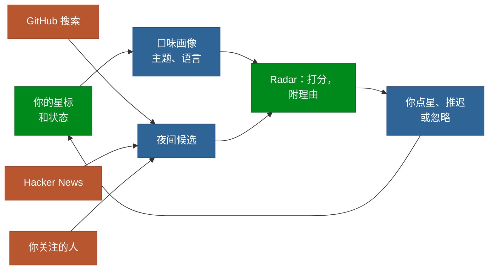

<a href="https://github.com/boffti/stardash">
  <picture>
    <source media="(prefers-color-scheme: dark)" srcset="assets/brand/banner-dark.svg">
    
  </picture>
</a>

<p align="center">
  <b>你给仓库点了星，然后就忘了。StarDash 记住每一个，替你分好类，并且每晚找出你的星标表明你会想要的新仓库。</b>
</p>

<p align="center">
<a href="https://github.com/boffti/stardash/actions/workflows/ci.yml"></a> <a href="LICENSE"></a> <a href="https://github.com/boffti/stardash/pkgs/container/stardash"></a>  
</p>

<p align="center">
  <a href="#为什么用-stardash">为什么用 StarDash</a> ·
  <a href="#快速开始">快速开始</a> ·
  <a href="#怎么用">怎么用</a> ·
  <a href="#看看里面">看看里面</a> ·
  <a href="#功能">功能</a> ·
  <a href="#路线图">路线图</a> ·
  <a href="CONTRIBUTING.md">参与贡献</a> ·
  <a href="README.md">English</a> ·
  <a href="README.ja.md">日本語</a>
</p>

<p align="center">
  
</p>

## 为什么用 StarDash

点星是开发者收藏仓库的方式。可是列表一过几百个，就不再好用了。StarDash 解决这两头的问题：

- **找到你点过星的东西。** 每个星标都能按名称、描述、你的笔记、标签和合集搜索。给每一个标上 `want-to-try`、`currently-using`、`tried-liked`、`tried-dropped`、`just-interesting` 或 `reference`，列表就能说明你用它做了什么。
- **不用手动整理。** 一次 AI 处理读取你最多 500 个星标，提出 5 到 12 个合集和 15 到 25 个标签，然后把所有仓库归好类。它生成的东西你可以保留、改名或删除。
- **知道下一个值得看的。** Radar 是一个新仓库和上升仓库的收件箱，按与你已有星标的契合度排序，每一行都写明它为什么出现。

**按你的口味排序，而不是按 GitHub 的。** Radar 从你的星标建立一个画像：你反复关注的主题和语言，再按你对每个仓库的处理方式加权。标为 `tried-dropped` 的星标会给它的主题减分。每晚它从 GitHub 搜索、Hacker News 和你关注的人那里拉取候选仓库，并用这个画像给每一个打分。你关注的人点过星，排名高于主题匹配。

**每一行都自带理由。** 没有黑箱分数。一行会写 _Matches ai, llm, python in your stars_、_3 people you follow starred this_、_+2.1k stars this week_ 或 _40 points on Hacker News_。用键盘推迟一周或忽略，点星只需一下。

**你的智能体也能用。** StarDash 自带 MCP 服务器。Claude Code、Cursor 或任何 MCP 客户端都能用你已经付费的订阅来搜索星标、归类，以及处理 Radar。

**数据在你自己的机器上。** 一个容器，一个 SQLite 文件。登录时会创建一个归你所有的 GitHub App，所以授权页面上不会出现别人的名字，也没有令牌离开你的机器。

### 同一个源，三个人

Radar 给每个人读的是同一批新仓库。哪个排在最前，取决于背后的星标：

| 你主要点星的是          | Radar 排在最前的，以及它显示的理由                                                                   |
| ----------------------- | ---------------------------------------------------------------------------------------------------- |
| Rust CLI 和终端工具     | 一个在 Hacker News 上有 40 分的新 Rust IDE。_Matches developer-tools, rust, terminal in your stars._ |
| LLM 智能体和 MCP 服务器 | 一个本周创建的智能体记忆库。_Matches ai, llm, python in your stars. Python, your usual._             |
| 在家里自托管的应用      | 一个你关注的三个人昨天点过星的家庭实验室面板。_People you follow_ 高于任何主题匹配。                 |

> [!NOTE]
> AI 是可选的。搜索、状态、笔记、Radar 以及浏览 Contribute 议题列表都不需要密钥。生成 Contribute 简报或编程助手提示词则需要配置 AI 服务商。Categorize、Intel 和 Discover 同样需要 AI。你可以配置 OpenRouter 密钥（`OPENROUTER_API_KEY`）、在设置中粘贴自己的 OpenAI 或 Anthropic 密钥，或通过 Ollama 等 OpenAI 兼容服务使用本地模型（`AI_BASE_URL`）。使用默认模型为 500 个仓库完整分类一次，大约一美分。

## 快速开始

你需要 Docker。

```bash
docker run -d --name stardash -p 3000:3000 -v stardash-data:/data ghcr.io/boffti/stardash:latest
```

打开 `http://localhost:3000`，点 **Connect GitHub**。GitHub 会显示一个页面，创建一个归你所有的 GitHub App：点 **Create GitHub App**，再点 **Authorize**。不用注册 OAuth 应用，也不用复制密钥。你的星标会同步，Radar 在第一次夜间扫描后填满，或者点 **Scan now** 立即开始。

### 替代方案：使用 Docker Compose 安装

Compose 是另一种全新安装方式；请用它替代上面的 `docker run` 命令，不要与其同时运行。它同样占用主机的 `3000` 端口，并创建自己的命名卷（通常为 `stardash_stardash-data`），因此会启动一个使用独立数据库的实例。

```bash
curl -O https://raw.githubusercontent.com/boffti/stardash/main/docker-compose.yml
OPENROUTER_API_KEY=sk-or-... docker compose up -d
```

更新任一种安装时，拉取新镜像并重建对应容器。请始终使用原来的数据卷。

**将现有 `docker run` 安装迁移到 Compose：** 停止并删除旧容器，但不要删除它的数据卷；然后编辑下载的 Compose 文件，将顶层卷声明改为复用现有卷：

```yaml
volumes:
  stardash-data:
    external: true
    name: stardash-data
```

之后再启动 Compose。不要让两个容器同时占用 `3000` 端口；如果要继续使用原数据库，也不要省略 `external` 映射。

## 工作原理



Next.js 16 单进程，通过 `node:sqlite` 使用 SQLite，没有外部服务。每晚在进程内运行两个任务：星标快照，给 Radar 提供增长速度数据；以及 Radar 采集，来源是 GitHub 搜索、Hacker News（通过 Algolia）和你关注的人的星标。整个打分函数在 [`lib/radar.ts`](lib/radar.ts) 里，共 156 行。

## 怎么用

### 用键盘处理 Radar

| 按键      | 作用                                      |
| --------- | ----------------------------------------- |
| `j` / `k` | 在收件箱里向下、向上移动                  |
| `x`       | 忽略，不会再出现。提示框里可以 **Undo**。 |
| `z`       | 推迟一周                                  |
| `o`       | 在 GitHub 上打开                          |

列表上方的方块可以筛选：**People you follow**、**Hacker News**、**Rising**、**New this week**。**From your stars** 显示从你最近的星标中挖掘出的推荐。

### 让智能体来做

在设置里打开 **Agents (MCP)**，点 **New token**，把它显示的配置粘贴到 `.mcp.json`（Claude Code）或你的客户端的 MCP 设置里：

```json
{
  "mcpServers": {
    "stardash": {
      "type": "http",
      "url": "http://localhost:3000/api/mcp",
      "headers": { "Authorization": "Bearer sd_…" }
    }
  }
}
```

然后用平常的话跟智能体说：

| 你说                                                        | 会发生什么                                                                                                                                  |
| ----------------------------------------------------------- | ------------------------------------------------------------------------------------------------------------------------------------------- |
| _“我点过星的向量数据库有哪些？”_                            | `search_stars` 在名称、描述、你的笔记、标签和合集中搜索。                                                                                   |
| _“介绍一下 duckdb，还有我写过的笔记。”_                     | `get_repo` 返回仓库以及你的状态、笔记、标签和合集。                                                                                         |
| _“把我点过星的 MCP 服务器都放进 Agents，并打上 mcp 标签。”_ | `list_taxonomy` 和 `organize_repo` 创建并分配标签和合集。请先在 StarDash 中同步 GitHub 星标；`organize_repo` 只能处理已同步到实例中的仓库。 |
| _“这周我的 Radar 上有什么？”_                               | `radar_feed` 返回排好序的收件箱，以及每一行的理由。                                                                                         |
| _“把 Radar 上又一个 Electron 套壳的都忽略掉。”_             | `radar_action` 忽略、推迟或撤销。                                                                                                           |
| _“给前两个点星，放进 Want to try。”_                        | `star_repo` 只会在 GitHub 上点星。请先在 StarDash 中同步星标，再用 `organize_repo` 设置状态、标签或合集。                                   |

## 看看里面

从早上喝咖啡时翻的收件箱，到你最后真正用上的仓库。

### Radar

<table>
<tr>
<td width="50%" valign="top"><br><b>收件箱。</b> 按你的星标排序的新仓库和上升仓库。每一行写明匹配原因，徽章标出最强的信号。</td>
<td width="50%" valign="top"><br><b>你关注的人。</b> 每种信号一个方块，点一下就能筛选。你关注的人点过星，排名高于任何主题匹配。</td>
</tr>
<tr>
<td width="50%" valign="top"><br><b>来自你的星标。</b> 从你最近的星标中挖掘出的推荐，按共同点分组。</td>
<td width="50%" valign="top"><br><b>Agents (MCP)。</b> 生成令牌，复制配置，你的智能体就能搜索、归类和处理 Radar。</td>
</tr>
</table>

### 你的星标

<table>
<tr>
<td width="50%" valign="top"><br><b>全部星标。</b> 每个星标都能按名称、描述、笔记、标签和合集搜索。</td>
<td width="50%" valign="top"><br><b>合集。</b> 你自己建的，或者由一次 AI 处理提出并替你归好类。</td>
</tr>
<tr>
<td width="50%" valign="top"><br><b>单个仓库。</b> 内嵌 README、主题、健康卡片，以及适合第一次贡献的开放议题。</td>
<td width="50%" valign="top"><br><b>Intel。</b> 每个仓库一份健康简报：分数、维护判断、社区信号和痛点。</td>
</tr>
</table>


<p align="center"><sub><b>Contribute。</b> 来自你已点星仓库的开放议题，按契合度排序，一键生成简报和给编程智能体的提示词。</sub></p>

## 功能

<table>
<tr>
<td width="50%" valign="top"><b>Radar</b><br>每晚的新仓库和上升仓库收件箱，来自 GitHub 搜索、Hacker News 和你关注的人，按你的星标排序，每个都附理由。</td>
<td width="50%" valign="top"><b>全部星标</b><br>最多 5,000 个星标，可按名称、描述、笔记、标签和合集搜索，每个都能设状态、写笔记、置顶。</td>
</tr>
<tr>
<td width="50%" valign="top"><b>AI 分类</b><br>一次处理从你的星标中提出合集和标签，并给每个仓库归类。之后再运行会沿用你的分类体系。</td>
<td width="50%" valign="top"><b>MCP 服务器</b><br>七个工具，适用于任何 MCP 客户端，使用你在设置里或命令行生成和撤销的 bearer 令牌。</td>
</tr>
<tr>
<td width="50%" valign="top"><b>Repo Intel</b><br>每个仓库一份健康简报：分数、维护判断、社区信号、痛点和建议。</td>
<td width="50%" valign="top"><b>Contribute</b><br>来自你已在用的仓库的 good first issue，附简报和可以直接粘贴给编程智能体的提示词。</td>
</tr>
<tr>
<td width="50%" valign="top"><b>Discover</b><br>描述你在做什么。AI 扩展查询，并对照你的星标重新排序 GitHub 搜索结果。</td>
<td width="50%" valign="top"><b>一个容器</b><br>一个镜像、一个 SQLite 文件、一个卷。支持 amd64 和 arm64。夜间任务在进程内运行。不需要 Postgres，也不需要 Redis。</td>
</tr>
</table>

## 你的数据

> [!IMPORTANT]
> 你的星标、状态、笔记、分类、Radar 历史和 GitHub App 凭据都保存在 `/data` 卷上的一个 SQLite 文件中。StarDash 会连接 GitHub 和 Hacker News 搜索 API；使用 AI 功能时，会向你配置的 AI 服务商发送请求。可选的可观测性集成也会向其配置的服务发送遥测数据：设置 Sentry DSN 后，Sentry 会接收错误和性能事件；只有同时设置 `LANGFUSE_PUBLIC_KEY` 与 `LANGFUSE_SECRET_KEY` 时，Langfuse 才会接收 AI traces。

| 内容                         | 位置                                    |
| ---------------------------- | --------------------------------------- |
| 星标、笔记、状态、标签、合集 | 卷上的 `stardash.db`                    |
| GitHub App 的 id 和密钥      | `stardash.db`，在设置时创建于你的账号下 |
| 你的登录                     | 签名 cookie，密钥在第一次启动时生成     |
| MCP 令牌                     | 只保存 SHA-256 哈希                     |

单一所有者：第一个登录的 GitHub 账号拥有这个实例。

<details>
<summary><strong>配置</strong></summary>

全部可选。

| 变量                                        | 用途                                                                          |
| ------------------------------------------- | ----------------------------------------------------------------------------- |
| `OPENROUTER_API_KEY`                        | 开启 AI 功能。                                                                |
| `AI_MODEL`                                  | 任意 OpenRouter 模型 id。默认是一个能处理结构化输出的便宜模型。               |
| `APP_URL`                                   | 公开地址，在反向代理不发送 `X-Forwarded-Host` 和 `X-Forwarded-Proto` 时使用。 |
| `GITHUB_CLIENT_ID` / `GITHUB_CLIENT_SECRET` | 使用你自己创建的 GitHub App，代替一键流程。                                   |
| `GITHUB_PAT`                                | 夜间任务用的令牌。默认使用所有者的。                                          |
| `CRON_SECRET`                               | 允许外部调度器调用 `/api/cron/*`。`DISABLE_SCHEDULER=1` 关闭进程内任务。      |
| `NEXT_PUBLIC_RADAR_ENABLED`                 | 设为 `false` 隐藏 Radar。                                                     |
| `DATABASE_PATH`                             | SQLite 文件。容器内为 `/data/stardash.db`。                                   |

**机器上没有浏览器：** 在登录页选择 _Paste a personal access token instead_。StarDash 目前只连接 GitHub.com，暂不支持 GitHub Enterprise Server。

**局域网内的纯 HTTP** 也能用，只是会话 cookie 不会标记为 Secure。公开访问请放在 HTTPS 后面。

#### 反向代理

在代理上终止 TLS，并转发原始的 host 和协议。GitHub App 的设置地址和 OAuth 回调地址都由这个来源生成。

**Caddy**

```caddyfile
stardash.example.com {
    reverse_proxy 127.0.0.1:3000 {
        header_up Host {host}
        header_up X-Forwarded-Host {host}
        header_up X-Forwarded-Proto {scheme}
    }
}
```

**nginx**

```nginx
server {
    listen 443 ssl;
    server_name stardash.example.com;

    # 在这里配置 ssl_certificate 和 ssl_certificate_key。
    location / {
        proxy_pass http://127.0.0.1:3000;
        proxy_set_header Host $host;
        proxy_set_header X-Forwarded-Host $host;
        proxy_set_header X-Forwarded-Proto $scheme;
    }
}
```

让 3000 端口保持私有，公开流量交给代理。设置了 `APP_URL` 时以它为准；否则依次使用 `X-Forwarded-Host` 和 `X-Forwarded-Proto`，最后是请求 URL。当代理无法可靠地传递这些头，或者你想固定规范地址时，设置 `APP_URL=https://stardash.example.com`（不带路径，不带结尾斜杠）。只信任你自己控制的代理发来的转发头。

**不用 Docker：** Node 22.5 或更高版本加 pnpm，然后运行 `pnpm install && pnpm build && pnpm start`。

</details>

## 路线图

- [x] 基于 SQLite 的单容器，通过归你所有的 GitHub App 登录
- [x] Radar：每晚从 GitHub 搜索、Hacker News 和你关注的人获取候选，按你的星标排序
- [x] MCP 服务器和命令行令牌
- [x] 用便宜模型实现 AI 分类、Intel、Contribute 和 Discover
- [ ] 发布 `v1.0.0`
- [ ] 通过命令行用智能体的订阅驱动 AI 功能，API 密钥作为后备
- [ ] 每周发布，每次一个看得见的改动

完整计划见 [ROADMAP.md](ROADMAP.md)。有想法？[开一个 issue](https://github.com/boffti/stardash/issues)。

## 参与贡献

```bash
pnpm install && pnpm dev     # 在 http://localhost:3000 登录，你运行的就是真实的应用
pnpm typecheck && pnpm lint && pnpm check:db && pnpm check:radar
```

标记为 [good first issue](https://github.com/boffti/stardash/issues?q=is%3Aissue+is%3Aopen+label%3A%22good+first+issue%22) 的议题小而独立。约定见 [CONTRIBUTING.md](CONTRIBUTING.md)。报告安全问题请按 [SECURITY.md](SECURITY.md) 操作。

<details>
<summary><strong>给 AI 智能体</strong></summary>

从 [AGENTS.md](AGENTS.md) 开始。它介绍了 `lib/db.ts` 中的数据结构、登录流程、Radar 打分、`lib/mcp-tools.ts` 中的 MCP 工具，以及每个页面遵循的 UI 规则。

</details>

<details>
<summary><strong>命令行参考</strong></summary>

`bin/stardash.mjs` 直接操作 SQLite 文件。在容器里，前面加上 `docker exec stardash node`。

```
bin/stardash.mjs token [name]       # 生成一个 MCP 令牌并只显示一次
bin/stardash.mjs tokens             # 列出令牌及最后使用时间
bin/stardash.mjs revoke <id>        # 撤销一个令牌
bin/stardash.mjs mcp-config [tok]   # 打印某个令牌的 .mcp.json 配置
```

</details>

## 许可证

[MIT](LICENSE)
