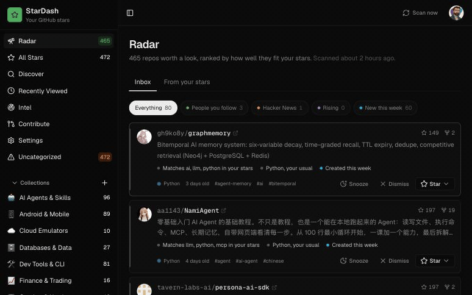

<div align="center">

<h1>StarDash</h1>

<p>你给仓库点了星，然后就忘了。StarDash 替你记住，还会告诉你哪些新仓库符合你的口味。</p>



<br/>

[](./LICENSE)
[](https://github.com/boffti/stardash/pkgs/container/stardash)
[](#在-ai-助手里使用mcp)
[](https://github.com/boffti/stardash/stargazers)

[English](./README.md)

</div>

## 运行

```bash
docker run -d --name stardash -p 3000:3000 -v stardash-data:/data ghcr.io/boffti/stardash:latest
```

打开 http://localhost:3000，点击 **Connect GitHub**，在 GitHub 上点击 **Create GitHub App**，然后授权。GitHub 上只需两次点击，不用自己注册 OAuth 应用，不用复制任何密钥。星标随即同步，Radar 会在夜间填充（或者点 **Scan now** 立即扫描）。

所有数据都在挂载卷上的一个 SQLite 文件里。它创建的 GitHub App 归你所有。

## 功能

|                |                                                                                                                                                                                                                                                 |
| -------------- | ----------------------------------------------------------------------------------------------------------------------------------------------------------------------------------------------------------------------------------------------- |
| **Radar**      | 收件箱式的新仓库和上升仓库，来源是 GitHub 搜索、Hacker News 和你关注的人，按与你星标的契合度排序。每一条都写明原因："你关注的 3 个人给它点了星"、"本周 +2.1k 星"、"匹配 local-first、sqlite"。可以点星、推迟、忽略。键盘：`j` `k` `x` `z` `o`。 |
| **All Stars**  | 全部星标仓库，可按名称、描述、笔记、标签和合集搜索。每个仓库可设置状态（`want-to-try`、`currently-using`、`tried-liked`、`tried-dropped`、`just-interesting`、`reference`）、笔记、置顶，内嵌 README。                                          |
| **合集与标签** | 手动维护，或者让 AI 一次处理最多 500 个仓库，生成 5 到 12 个合集和 15 到 25 个标签并自动归档。                                                                                                                                                  |
| **Repo Intel** | 每个仓库一份健康报告：评分、维护状况判断、社区信号、痛点、建议。                                                                                                                                                                                |
| **Contribute** | 从你已经星标的仓库里找开放的 issue，按匹配度排序，一键生成贡献简报和可直接粘贴给编程助手的提示词。                                                                                                                                              |
| **Discover**   | 描述你在做什么，AI 扩展查询并对 GitHub 搜索结果重新排序。                                                                                                                                                                                       |
| **MCP 服务器** | Claude Code、Cursor 或任何 MCP 客户端都能用你自己的订阅来搜索、整理和处理你的星标。                                                                                                                                                             |

AI 功能需要一个 OpenRouter 密钥（`OPENROUTER_API_KEY`，或在设置里粘贴你自己的）。默认模型下，对 500 个仓库做一次完整分类大约花费一美分。其余功能无需密钥。

## 在 AI 助手里使用（MCP）

1. 设置 → **Agents (MCP)** → New token，复制显示的配置。
2. 粘贴到 `.mcp.json`（Claude Code）或你客户端的 MCP 设置里。

```json
{
  "mcpServers": {
    "stardash": {
      "type": "http",
      "url": "http://localhost:3000/api/mcp",
      "headers": { "Authorization": "Bearer sd_…" }
    }
  }
}
```

工具：`search_stars`、`get_repo`、`list_taxonomy`、`organize_repo`、`radar_feed`、`radar_action`、`star_repo`。也可以在命令行里生成：`docker exec stardash node bin/stardash.mjs token claude-code`。

## 配置

全部可选。

| 变量                                        | 作用                                                                                     |
| ------------------------------------------- | ---------------------------------------------------------------------------------------- |
| `OPENROUTER_API_KEY`                        | 开启 AI 功能。                                                                           |
| `AI_MODEL`                                  | 任意 OpenRouter 模型 id。默认是一个便宜的结构化输出模型。                                |
| `APP_URL`                                   | 公网地址，仅当反向代理不传 `X-Forwarded-Host` 和 `X-Forwarded-Proto` 时需要。            |
| `GITHUB_CLIENT_ID` / `GITHUB_CLIENT_SECRET` | 使用预先创建的 GitHub App，而不是一键流程。                                              |
| `GITHUB_PAT`                                | 夜间任务使用的令牌。默认使用登录用户的。                                                 |
| `CRON_SECRET`                               | 允许外部调度器调用 `/api/cron/*`。夜间任务已在进程内运行；`DISABLE_SCHEDULER=1` 可关闭。 |
| `NEXT_PUBLIC_RADAR_ENABLED`                 | 设为 `false` 隐藏 Radar。                                                                |
| `DATABASE_PATH`                             | SQLite 文件路径。容器内为 `/data/stardash.db`。                                          |

使用 Compose 并传入密钥：

```bash
curl -O https://raw.githubusercontent.com/boffti/stardash/main/docker-compose.yml
OPENROUTER_API_KEY=sk-or-... docker compose up -d
```

**GitHub Enterprise 或没有浏览器的机器：** 在登录页选择 "Paste a personal access token instead"。

**局域网内的纯 HTTP** 可以正常使用，只是会话 cookie 不带 Secure 标记。对外暴露请放在 HTTPS 之后。

**不用 Docker：** Node 22.5+ 和 pnpm，然后 `pnpm install && pnpm build && pnpm start`。

## 工作原理

Next.js 16 应用，单进程。数据通过 `node:sqlite` 存在 SQLite 里，没有 ORM，没有外部服务。登录使用 GitHub App manifest 流程：实例请求 GitHub 创建一个归你所有的 App，把凭据存在本地，然后走标准 OAuth（8 小时令牌加刷新）。夜间在进程内运行：星标快照（用于计算增速）和 Radar 抓取（GitHub 搜索、Algolia 的 Hacker News、你关注的人的点星）。Radar 评分先从你的星标构建口味画像（主题和语言按状态加权，`tried-dropped` 为负），再应用到每个候选仓库；社交信号的权重高于主题匹配。整个评分函数在 `lib/radar.ts`，156 行。

## 参与贡献

`pnpm install && pnpm dev`，登录后就是完整的应用。提 PR 前运行 `pnpm typecheck && pnpm lint && pnpm check:db && pnpm check:radar`。标有 [good first issue](https://github.com/boffti/stardash/issues?q=is%3Aissue+is%3Aopen+label%3A%22good+first+issue%22) 的 issue 小而独立；[路线图](https://github.com/boffti/stardash/issues/86) 说明接下来要做什么。另见 [CONTRIBUTING.md](./CONTRIBUTING.md)。

## 许可证

MIT
