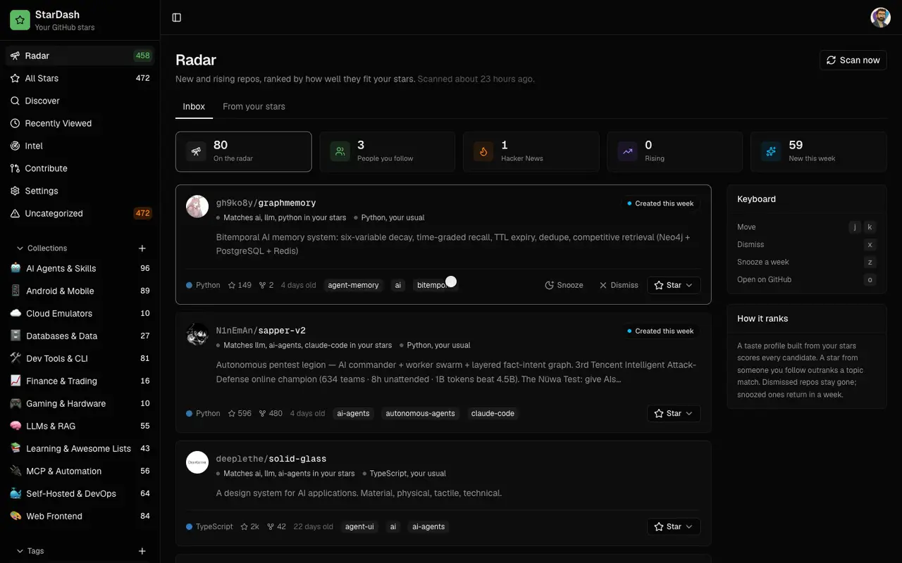

# StarDash v1.0.0

First tagged release. StarDash is a self-hosted dashboard for your GitHub stars: it remembers what you starred, and Radar tells you which new repos your taste says to look at.



## Run it

```bash
docker run -d --name stardash -p 3000:3000 -v stardash-data:/data ghcr.io/boffti/stardash:1.0.0
```

Open http://localhost:3000, click **Connect GitHub**, click **Create GitHub App**, authorize. No OAuth app to register, no secrets to copy. Your stars sync and Radar fills overnight, or hit **Scan now**.

Image tags: `1.0.0`, `1.0`, `latest`. Multi-arch (amd64, arm64).

## What is in 1.0

**Radar is the front door.** An inbox of new and rising repos from GitHub search, Hacker News and the people you follow, ranked against your own stars. Every row says why it surfaced: "3 people you follow starred this", "+2.1k stars this week", "matches local-first, sqlite". Star, snooze, dismiss. Keyboard: `j` `k` `x` `z` `o`.

**One container, one file.** SQLite through `node:sqlite`, no ORM, no external services. Everything lives on the `/data` volume. Nightly jobs (star snapshots, Radar ingest) run in-process.

**Sign in without setup.** The instance creates its own GitHub App through the manifest flow. Two clicks on GitHub and the app is yours. Paste a personal access token instead for GitHub Enterprise or headless boxes.

**MCP server.** Claude Code, Cursor or any MCP client can search, organize and triage your stars with your own subscription. Tools: `search_stars`, `get_repo`, `list_taxonomy`, `organize_repo`, `radar_feed`, `radar_action`, `star_repo`. Mint tokens in Settings, or from a shell with `docker exec stardash node bin/stardash.mjs token claude-code`.

**AI on cheap models.** Collections and tags from one pass over up to 500 repos (about a cent on the default OpenRouter model), repo health reports, contribution briefs, AI-expanded Discover search. Bring an OpenRouter, OpenAI or Anthropic key. Everything else works without one.

**Also:** All Stars view with status per repo (`want-to-try`, `currently-using`, `tried-liked`, `tried-dropped`, `just-interesting`, `reference`), notes, pins and inline README. Contribute view ranks open issues from repos you already starred. Chinese README.

## Changes since the rewrite began

- feat(radar): radar is the front door (#98)
- feat: single-container StarDash: SQLite, self-created GitHub App login, working AI on cheap models (#89)
- chore(deps): batch Dependabot updates (next 16.3.3, eslint 10.10, prettier 3.9.6) (#87)
- feat(radar): Radar feed behind a flag, v1 roadmap, README banner (#85)

## Upgrading from the Supabase version

There is no migration path. 1.0 is a rewrite: SQLite instead of Supabase, in-process jobs instead of Vercel cron, a self-created GitHub App instead of a hand-registered OAuth app. Run the container, sign in, and your stars sync fresh from GitHub. Tags, collections and notes from the old hosted instance do not carry over.

## Configuration

All optional. `OPENROUTER_API_KEY`, `AI_MODEL`, `APP_URL`, `GITHUB_CLIENT_ID` / `GITHUB_CLIENT_SECRET`, `GITHUB_PAT`, `CRON_SECRET`, `NEXT_PUBLIC_RADAR_ENABLED`, `DATABASE_PATH`. See the [README](https://github.com/boffti/stardash#configuration).

## Thanks

Roadmap and what is next: [#86](https://github.com/boffti/stardash/issues/86). Issues labelled `good first issue` are small and self-contained.

MIT.
